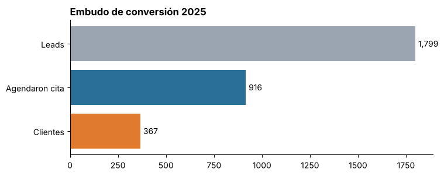
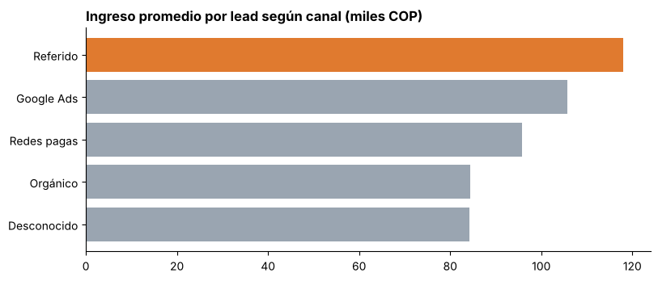

# 🔄 Pipeline ETL de Leads y Calidad de Datos · Python

> **EN:** Python ETL pipeline that consolidates messy lead exports from web forms, Calendly and Google Sheets, applies data-quality rules, loads a clean table into SQLite and analyzes the conversion funnel.

## Problema de negocio
Los leads de una empresa de trámites llegaban desde **3 fuentes** (formularios de WordPress, Calendly y Google Sheets), cada una con su propio formato. Había duplicados, teléfonos y fechas inconsistentes y ciudades escritas de 19 formas distintas, lo que hacía imposible medir correctamente la conversión.

## Herramientas
`Python` · `pandas` · `SQLite` · `pytest` · `logging` · `matplotlib` · `Jupyter`

## Arquitectura
```
 data/raw/leads_export.csv
          │  extract()
          ▼
   transform()  → normaliza nombres, emails, teléfonos (+57), ciudades, fechas (3 formatos),
          │        booleanos y montos · elimina duplicados entre fuentes
          ▼
   validate()   → 6 reglas de negocio (falla el pipeline si alguna no se cumple)
          │
          ▼
   load()       → data/processed/leads_limpios.csv  +  leads.db (SQLite)
          │
          ▼
   reports/reporte_calidad.md  (generado automáticamente)
```

## Resultados de la limpieza
| Métrica | Antes | Después |
|---|---|---|
| Filas | 1.950 | **1.799** (151 duplicados eliminados) |
| Variantes de ciudad | 19 | **6** estandarizadas |
| Formatos de fecha | 3 | **1** (datetime) |
| Formatos de teléfono | 5 | **1** (E.164 `+573XXXXXXXXX`) |
| Leads contactables | — | **99,7%** |

Ver el [reporte de calidad](reports/reporte_calidad.md) completo.

## Hallazgos del embudo
- Conversión global lead → cliente: **20,4%** (1.799 leads → 916 citas → 367 clientes).
- **Calendly convierte 46%** vs **11,5%** de los formularios web → enlazar el agendamiento desde los formularios.
- El canal **Referido** genera el mayor ingreso por lead (~118 mil COP).
- *Asesoría migratoria* tiene la mayor tasa de cierre tras la cita (**52,9%**).




📓 Análisis: [`notebooks/analisis_embudo.ipynb`](notebooks/analisis_embudo.ipynb)

## Cómo ejecutarlo
```bash
python -m venv .venv
.venv\Scripts\activate
pip install -r requirements.txt
python src/generar_datos_crudos.py   # simula la exportación sucia
python src/etl.py                    # corre el pipeline completo
pytest -q                            # 5 pruebas unitarias de las funciones de limpieza
```

> ℹ️ Datos **sintéticos** que reproducen los problemas reales que encontré automatizando flujos entre WordPress, Google Sheets y Calendly.

---
**Juan Camilo Castro López** · Analista de Datos Jr · [LinkedIn](https://www.linkedin.com/in/juancastrolopez/)
